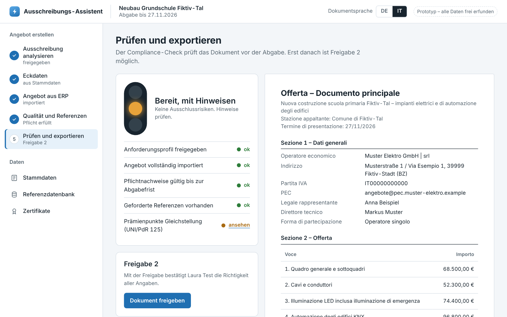
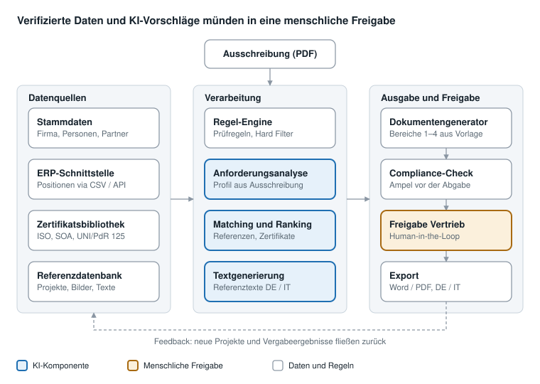
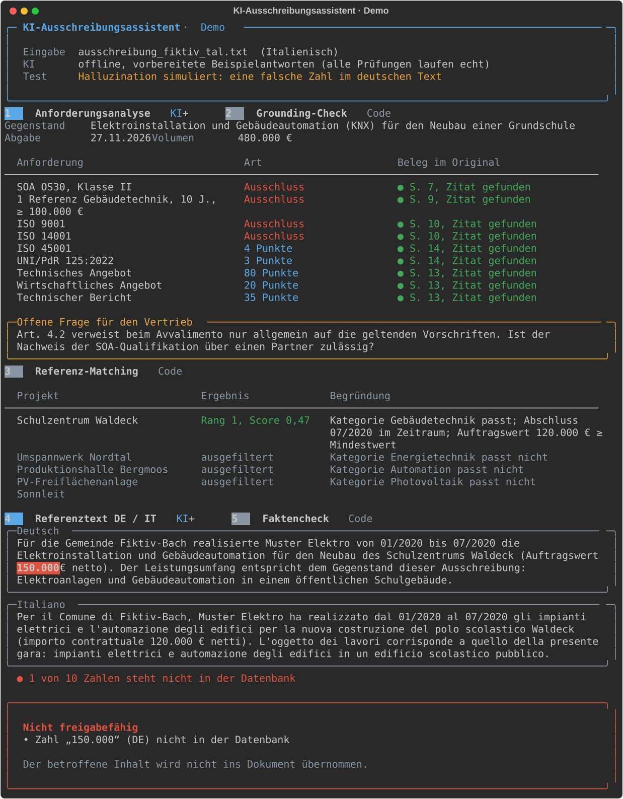

# KI-gestütztes Ausschreibungstool

[](https://github.com/27-ayb/ki-ausschreibungstool/actions/workflows/tests.yml)

Ein Konzept mit klickbarem Prototyp für ein Tool, das das Hauptdokument öffentlicher Ausschreibungen weitgehend automatisch erstellt. Es richtet sich an Unternehmen der Elektrotechnik und berücksichtigt das italienische Vergaberecht, SOA-Qualifikationen und zweisprachige Unterlagen (Deutsch/Italienisch).

**Klickbarer Prototyp:** [27-ayb.github.io/ki-ausschreibungstool](https://27-ayb.github.io/ki-ausschreibungstool/)  
**KI-Demo mit Code:** [`demo/`](demo/)



> **Leitprinzip: Die KI schlägt vor, der Mensch entscheidet.**
> Die KI arbeitet nur mit geprüften Daten aus den eigenen Datenbanken, erfindet keine Fakten, und jedes Dokument wird vor der Abgabe von einer verantwortlichen Person freigegeben.

---

## Inhalt

- [Problem und Lösung](#problem-und-lösung)
- [Funktionen des Prototyps](#funktionen-des-prototyps)
- [Architektur](#architektur)
- [KI-Einsatz](#ki-einsatz)
- [KI-Demo](#ki-demo)
- [Matching-Logik](#matching-logik)
- [Projektstruktur](#projektstruktur)
- [Lokal ausführen](#lokal-ausführen)
- [Datenschutz und Compliance](#datenschutz-und-compliance)
- [Roadmap](#roadmap)

---

## Problem und Lösung

Für jede Ausschreibung stellt der Vertrieb heute Eckdaten, Angebotspositionen, Qualitätsnachweise und Referenzen manuell zusammen. Die Informationen liegen verteilt im ERP, in Dateiablagen und im Wissen einzelner Personen. Unter Fristdruck führt das zu zwei Risiken: **Ausschluss** wegen eines fehlenden oder abgelaufenen Nachweises und **Punktverlust**, weil nicht die stärksten Referenzen eingereicht werden.

Das Tool befüllt die vier Bereiche des Hauptdokuments aus geprüften Quellen:

| Bereich | Datenquelle | Automatisierung |
| --- | --- | --- |
| 1 – Eckdaten | Stammdaten (Single Source of Truth) | vollautomatisch |
| 2 – Angebot | ERP-Schnittstelle | vollautomatisch, mit Plausibilitätsprüfung |
| 3 – Qualitätsunterlagen | Zertifikatsbibliothek + KI-Anforderungsanalyse | KI-Vorschlag, Freigabe durch den Vertrieb |
| 4 – Referenzen | Referenzdatenbank + KI-Matching | KI-Vorschlag, Freigabe durch den Vertrieb |

## Funktionen des Prototyps

Der Prototyp ist eine einzelne HTML-Datei ohne Backend. Er zeigt den vollständigen Ablauf mit fiktiven Daten.

| Schritt | Was passiert | Screenshot |
| --- | --- | --- |
| 1. Ausschreibung analysieren | Die KI extrahiert Fristen, SOA-Kategorie, Referenz- und Zertifikatsanforderungen, jeweils mit Fundstelle. Bid/No-Bid und **Freigabe 1**. | [ansehen](docs/screenshots/01_anforderungsanalyse.png) |
| 2. Eckdaten | Automatisch aus den Stammdaten, wahlweise als Bietergemeinschaft. | – |
| 3. Angebot aus ERP | Import der Positionen, Plausibilitätsprüfung erkennt eine Position ohne Preis. | [ansehen](docs/screenshots/02_erp_import.png) |
| 4. Qualität und Referenzen | Zertifikate werden gegen die Abgabefrist geprüft (ISO 14001 läuft vorher ab → Ausschlussrisiko). Referenzen werden gefiltert, gerankt und begründet. | [ansehen](docs/screenshots/03_qualitaet_referenzen.png) |
| 5. Prüfen und exportieren | Compliance-Ampel, **Freigabe 2**, Dokumentvorschau auf Deutsch oder Italienisch, Protokoll aller Schritte. | [ansehen](docs/screenshots/04_pruefen_export_it.png) |

**Zum Ausprobieren:** Im Schritt „Ausschreibung analysieren“ den Referenzzeitraum von 10 auf 5 Jahre ändern. Das einzige passende Projekt fällt heraus, und das Tool meldet vor der Abgabe eine Referenzlücke.

## Architektur



Die KI greift nie direkt auf die Ausgabe zu: Ihre Vorschläge laufen immer durch Compliance-Check und menschliche Freigabe. Alle Module sind austauschbar (anderes ERP, anderes Sprachmodell), ohne Vendor Lock-in.

| Modul | Technologie (MVP-Vorschlag) |
| --- | --- |
| Datenbank | PostgreSQL, Vektor-Erweiterung für semantische Suche |
| Backend, Regel-Engine | Python |
| KI | Large Language Model über API mit EU-Datenresidenz |
| Dokumente | Word-Vorlagen (docx), PDF-Export |
| Frontend | Web-App mit Single Sign-On und Rollenkonzept |

## KI-Einsatz

KI wird nur dort eingesetzt, wo Sprache verstanden oder erzeugt werden muss. Alles, was eine feste Regel ist (Gültigkeitsdaten, Summen, Filter), bleibt bewusst regelbasiert und damit vollständig nachvollziehbar.

| Use Case | Ergebnis | Absicherung | Prompt |
| --- | --- | --- | --- |
| Anforderungsanalyse | Strukturiertes Anforderungsprofil aus dem Ausschreibungstext | Fundstelle je Anforderung, `null` statt Schätzung | [01](prompts/01_anforderungsanalyse.md) |
| Qualitätsunterlagen | Zuordnung Anforderung ↔ Nachweis, Liste der Lücken | Nur vorhandene Nachweise, Gültigkeit per Code | [02](prompts/02_qualitaetsunterlagen.md) |
| Referenz-Matching | Gerankte Referenzen mit Begründung | Hard Filter vor dem Ranking | [Code](matching/matching.py) |
| Textgenerierung | Referenztext auf Deutsch und Italienisch | Nur Datenbankfakten, automatischer Zahlenabgleich | [03](prompts/03_referenztext.md) |

**Guardrails gegen Halluzinationen**

- **Grounding (RAG):** Die KI erhält nur die relevanten Datensätze als Kontext.
- **Strukturierte Ausgabe:** feste JSON-Schemas ([`schemas/`](schemas/)); unvollständige Antworten werden abgelehnt.
- **Faktencheck:** Jede Zahl im generierten Text wird mit der Datenbank verglichen.
- **Quellenpflicht:** Jede extrahierte Anforderung verweist auf ihre Fundstelle.
- **Human-in-the-Loop:** zwei verbindliche Freigabepunkte.

## KI-Demo

Die [KI-Demo](demo/) zeigt den Kern als lauffähigen Code: Eine **italienische Ausschreibung** wird per Sprachmodell in ein **deutsches Anforderungsprofil** übersetzt (Structured Outputs mit Pydantic), mit der Referenzdatenbank abgeglichen und in einen **zweisprachigen Referenztext** überführt. Danach prüft der Code jedes Zitat gegen das Original und jede Zahl gegen die Datenbank.

Mit `--halluzination` schleust die Demo absichtlich eine falsche Zahl ein. Der Faktencheck findet sie und sperrt die Freigabe:



## Matching-Logik

Die Auswahl der Referenzen folgt drei Stufen:

1. **Hard Filter (Regeln):** Kategorie, Referenzzeitraum, Mindestauftragswert, Auftraggebertyp, Status „geprüft“ und Kundenfreigabe. Was hier herausfällt, wird nie vorgeschlagen.
2. **Ranking (Score):** gewichtete Summe aus vier Teilwerten zwischen 0 und 1.
3. **Auswahl durch den Vertrieb:** Das System zeigt zu jedem Vorschlag die Begründung.

```
Score = 0,50 × Inhalt + 0,25 × Größe + 0,15 × Aktualität + 0,10 × Auftraggeber
```

| Teilwert | Berechnung |
| --- | --- |
| Inhalt | Semantische Ähnlichkeit von Projektbeschreibung und Ausschreibungsgegenstand (Embedding-Vergleich) |
| Größe | kleinerer ÷ größerer Wert von Auftragswert und Ausschreibungsvolumen |
| Aktualität | 1 − Projektalter ÷ Referenzzeitraum |
| Auftraggeber | 1 bei öffentlichem, 0,5 bei privatem Auftraggeber |

Die Logik ist in [`matching/matching.py`](matching/matching.py) implementiert und mit Tests abgesichert. Ausgabe der Demo:

```
Referenzzeitraum 10 Jahre  →  Ampel: GRÜN
  1. Schulzentrum Waldeck  (Score 0.47)  – Kategorie Gebäudetechnik passt; Abschluss 07/2020 im Zeitraum; …
  ✗  Umspannwerk Nordtal  – Kategorie Energietechnik passt nicht
  …
Referenzzeitraum 5 Jahre  →  Ampel: ROT – Referenzlücke
  ✗  Schulzentrum Waldeck  – Abschluss 07/2020 vor dem 27.11.2021
```

> In der Demo ersetzt eine einfache Wortüberschneidung den Embedding-Vergleich, damit der Code ohne API-Schlüssel läuft. Der Prototyp verwendet für den Teilwert „Inhalt“ einen simulierten Embedding-Wert, deshalb weicht sein Score (0,68) von der Demo ab.

## Projektstruktur

```
ki-ausschreibungstool/
├── index.html                          Klickbarer Prototyp (eine Datei, kein Build nötig)
├── data/
│   ├── referenzprojekte.json           Testdaten der Referenzdatenbank (DE/IT)
│   └── beispiel_anforderungsprofil.json   Beispiel-Ergebnis der Anforderungsanalyse
├── matching/
│   ├── matching.py                     Hard Filter, Score, Ranking, Ampel
│   └── test_matching.py                Tests der Matching-Logik
├── demo/
│   ├── pipeline.py                     KI-Demo: Ausschreibung → Profil → Matching → Text → Faktencheck
│   ├── modelle.py                      Pydantic-Datenmodelle für die KI-Ausgaben
│   ├── ki.py                           KI-Schicht (live über die Claude API oder offline)
│   ├── pruefungen.py                   Grounding-Check und Faktencheck
│   └── test_demo.py                    Tests der Guardrails und der Pipeline
├── prompts/                            Prompt-Bibliothek, von der Demo direkt geladen
├── schemas/                            JSON-Schemas für die strukturierten KI-Ausgaben
├── docs/                               Architektur, Screenshots, Terminal-Aufnahmen
├── pyproject.toml, uv.lock             Abhängigkeiten, reproduzierbar mit uv
├── .github/workflows/tests.yml         Automatische Prüfung bei jeder Änderung
└── .devcontainer/                      Entwicklungsumgebung für GitHub Codespaces
```

## Lokal ausführen

**Prototyp:** `index.html` herunterladen und im Browser öffnen. Es wird nichts installiert.

**KI-Demo, Matching und Tests** mit [uv](https://docs.astral.sh/uv/):

```bash
uv run demo/pipeline.py --offline        # KI-Demo ohne API-Schlüssel
uv run demo/pipeline.py --halluzination  # Faktencheck in Aktion
uv run python matching/matching.py       # nur die Matching-Logik
uv run pytest                            # alle 19 Tests
```

**Ohne Installation:** Code → Codespaces → Create codespace öffnet eine fertige Entwicklungsumgebung im Browser.

## Datenschutz und Compliance

- **DSGVO:** Datenminimierung, Hosting und KI-Verarbeitung in der EU, Auftragsverarbeitungsvertrag, keine Nutzung der Daten für das Training fremder Modelle.
- **EU AI Act:** Nach erster Einschätzung kein Hochrisiko-System, da das Tool Dokumente vorbereitet und keine Entscheidungen über Personen trifft. Menschliche Aufsicht ist durch zwei Freigabepunkte gesichert.
- **Nachvollziehbarkeit:** Ein Protokoll erfasst jeden KI-Vorschlag, jede Änderung und jede Freigabe.

## Roadmap

| Phase | Zeitraum | Inhalt |
| --- | --- | --- |
| 1 – MVP | Monate 1–3 | Stammdaten, ERP-Import, Zertifikate, Referenzen, Dokumentengenerator DE/IT, Pilot mit zwei Nutzer:innen |
| 2 – Bid Assistant | Monate 4–9 | ERP-API, Optimierung der Qualitätspunkte, erweiterte Compliance-Ampel, Rollout |
| 3 – Vision | ab Monat 10 | Tender-Radar für Vergabeportale, Bid/No-Bid-Score, Gap-Analyse für Bietergemeinschaften, Knowledge Flywheel |

Jede Phase startet erst, wenn die vorherige ihre Ziele messbar erreicht hat.

---

**Hinweis:** Alle Firmen-, Personen- und Projektdaten in diesem Repository sind frei erfunden.

Konzept, Datenmodell, Prompts und Prototyp: **Ayoub Khadra**, 2026  
© 2026 Ayoub Khadra. Portfolio-Projekt, alle Rechte vorbehalten. Nutzung oder Weiterverwendung auf Anfrage.
